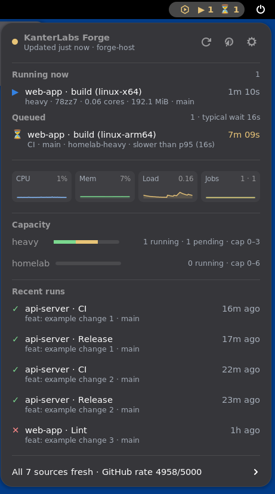
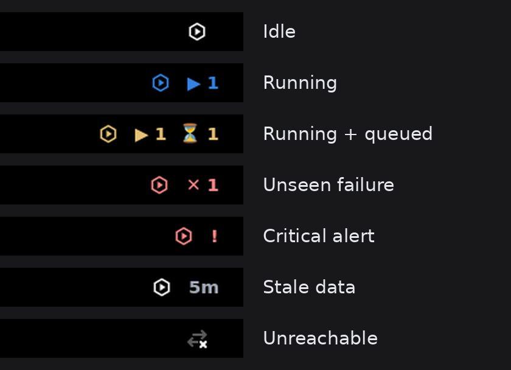
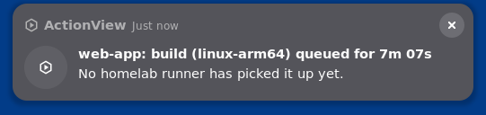
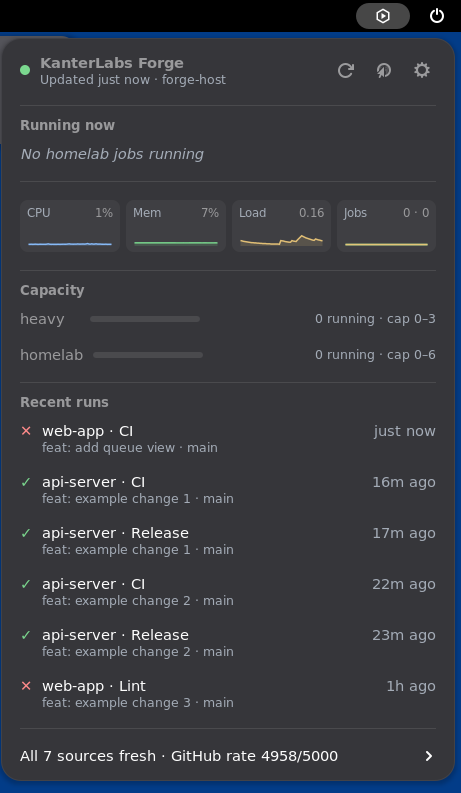
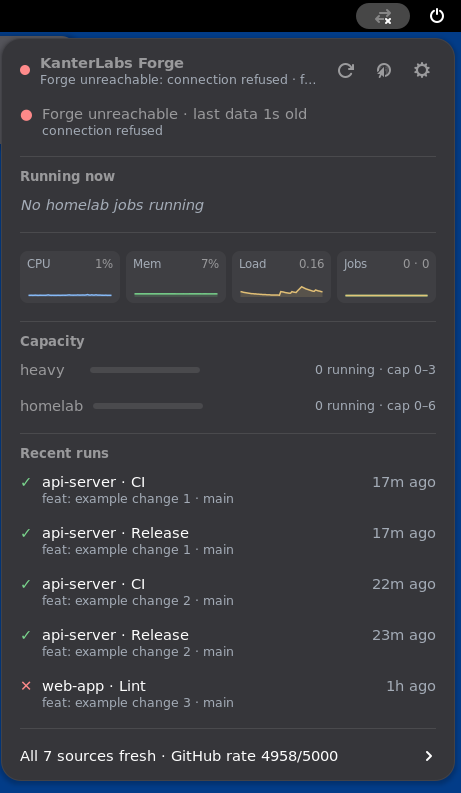
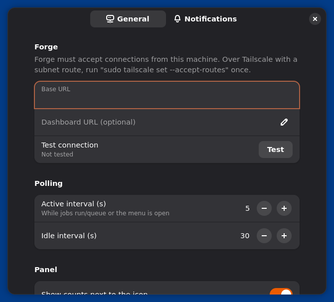
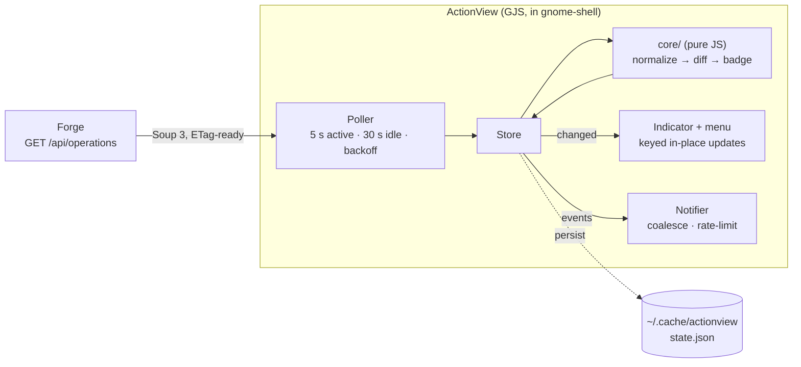

<div align="center">



<br>

**Your self-hosted GitHub Actions runners, live in the GNOME top bar.**

[](https://github.com/KanterLabs/ActionView/actions/workflows/ci.yml)


[Quick start](#quick-start) ·
[Features](#features) ·
[Configuration](#configuration) ·
[How it works](#how-it-works) ·
[Development](#development)

</div>

---

ActionView is a GNOME Shell extension for **KanterLabs Forge**, the dashboard
that watches our Kubernetes (ARC) runner fleet. It replaces "keep a browser
tab open and refresh it". A panel badge tells you at a glance whether
anything is running, queued, failed, or broken. The dropdown has the detail,
and a notification finds you when a run fails or a job is stuck waiting for a
runner.

It is deliberately a **thin client**. ActionView reads one read-only endpoint,
Forge's `/api/operations`. It never talks to GitHub or Kubernetes itself, so
there are no tokens on your desktop and no second consumer of your GitHub
rate limit.

<a id="quick-start"></a>

## 🚀 Quick start

You need GNOME Shell 48, 49 or 50, and network access to a Forge instance.

```sh
git clone https://github.com/KanterLabs/ActionView.git && cd ActionView
make install                                       # pack + install (compiles schemas)
# Wayland: log out and back in, then
gnome-extensions enable actionview@kanterlabs.dev
gnome-extensions prefs actionview@kanterlabs.dev   # set the Forge URL, then "Test connection"
```

Until a URL is set, the badge shows the unreachable icon and the menu says
**Forge URL not set**.

<details>
<summary>Reaching Forge over Tailscale</summary>

If Forge sits on a LAN that a Tailscale node advertises as a subnet route,
accept routes once on the desktop:

```sh
sudo tailscale set --accept-routes
curl -s -o /dev/null -w "%{http_code}\n" http://<forge-host>:8090/healthz   # expect 200
```

With SNAT on the router (the Tailscale default), requests reach Forge from the
router's LAN address. If that address is on Forge's allowlist, you need no
firewall change.

</details>

<a id="features"></a>

## ✨ Features

<table>
<tr>
<td width="50%" valign="top">

### 🟢 A badge you can trust
The icon changes colour and shows counts: `▶ 1` running, `⏳ 2` queued,
`✕ 1` for a failure you haven't looked at, `!` for a critical alert. When the
data is stale or Forge is unreachable, the badge **says so**, and it never
shows "all quiet" on data it can't vouch for.

</td>
<td width="50%" valign="top">



</td>
</tr>
<tr>
<td valign="top">



</td>
<td valign="top">

### 🔔 Notifications that respect you
You get notified when a run fails, a job waits past your threshold, Forge
raises or clears an alert, a data source goes stale, or Forge goes down or
comes back. A failed 6-way matrix run is **one** notification. Each one has
**Open log** and **Mute repo** actions, and there's a rate limit. Success and
job-start notifications are opt-in.

</td>
</tr>
<tr>
<td valign="top">

### 📋 The detail, one click away
- Running jobs with a live elapsed timer, runner, CPU and memory.
- The queue, with each wait compared against that repo's p95.
- CPU / memory / load / jobs sparklines.
- Capacity per runner pool, with dead `cap 0–0` pools hidden.
- Recent runs, with fresh failures pinned for an hour.
- Data sources in one line, expanded only when one isn't fresh.

</td>
<td valign="top">



</td>
</tr>
<tr>
<td valign="top">



</td>
<td valign="top">

### 🛡️ Honest when it can't see
Unreachable Forge, a hung collector (`generated_at` stops moving), a stale
source (debounced over two polls), and an unknown schema version each get a
banner with the reason. Opening the menu counts as "seen" and clears the red
failure badge.

</td>
</tr>
</table>

<a id="configuration"></a>

## ⚙️ Configuration

Everything is in the preferences window, stored in GSettings
(`org.gnome.shell.extensions.actionview`).



| Key | Default | Purpose |
| --- | --- | --- |
| `base-url` | *(empty)* | Forge URL, e.g. `http://forge.example:8090` |
| `dashboard-url` | *(empty = base URL)* | What "Open dashboard" opens |
| `poll-active-seconds` | `5` | Poll interval while jobs run/queue or the menu is open |
| `poll-idle-seconds` | `30` | Poll interval when idle (backs off 5 → 60 s on errors) |
| `notify-failure` / `notify-queued` / `notify-alerts` | `true` | Failures, long queues, alerts + stale sources |
| `notify-success` / `notify-start` | `false` | Opt-in noise |
| `queued-alert-minutes` | `5` | Queue wait before notifying |
| `muted-repos` | `[]` | No notifications, not counted in the badge, dimmed in the menu |
| `panel-show-label` / `panel-box` | `true` / `right` | Counts next to the icon; panel position |

<a id="how-it-works"></a>

## 🏗️ How it works



- **`lib/core/` is pure JavaScript with no `gi://` imports.** It covers
  normalizing the payload, the event state machine, the badge priority, and
  notification planning. The same tests run under both `gjs` and `node`.
- **The diff state machine is persisted.** Locking the screen disables
  extensions, but a failure that happens while you're away is still reported.
  State older than an hour starts a fresh baseline instead of replaying the
  weekend.
- **Re-runs are caught.** GitHub re-runs keep their run ID, so ActionView also
  reports a run it saw active again whose `updated_at` changed.
- **Alert keys ignore live numbers.** "Memory at 81.3%" becoming "81.9%" is
  still one alert, not one per poll.

<a id="development"></a>

## 🛠️ Development

```sh
make test     # core unit tests under gjs AND node
make lint     # ESLint 10 flat config
make smoke    # real headless gnome-shell end-to-end (see below)
make pack     # build/actionview@kanterlabs.dev.shell-extension.zip
```

`make smoke` starts a **real gnome-shell 50** in a headless Wayland session
with a throwaway `HOME`, installs the packed zip, and has a test-only driver
extension walk through 9 scenarios: idle, running, queued, failure,
critical alert, stale source, hung collector, future schema, and unreachable.
It records the badge, screenshots every state (the images in this README come
from it), opens the prefs window, runs 20 enable/disable cycles, and fails on
any ActionView error in the shell log. CI runs it on every push.

Test fixtures are real Forge payloads that go through
[`tools/sanitize-fixture.py`](tools/sanitize-fixture.py). It replaces repos,
titles, users, hosts, workflow and job names with demo values, and it fails if
any original identifier survives.
[`tools/readme-shots.py`](tools/readme-shots.py) regenerates the screenshots.

Design notes, decisions and what's deferred are in [`PLAN.md`](PLAN.md).

---

<div align="center">
<sub>Built by <a href="https://github.com/KanterLabs">KanterLabs</a>.</sub>
</div>
